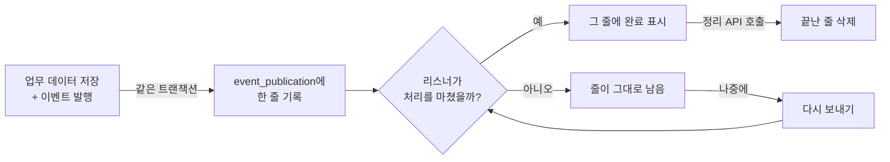
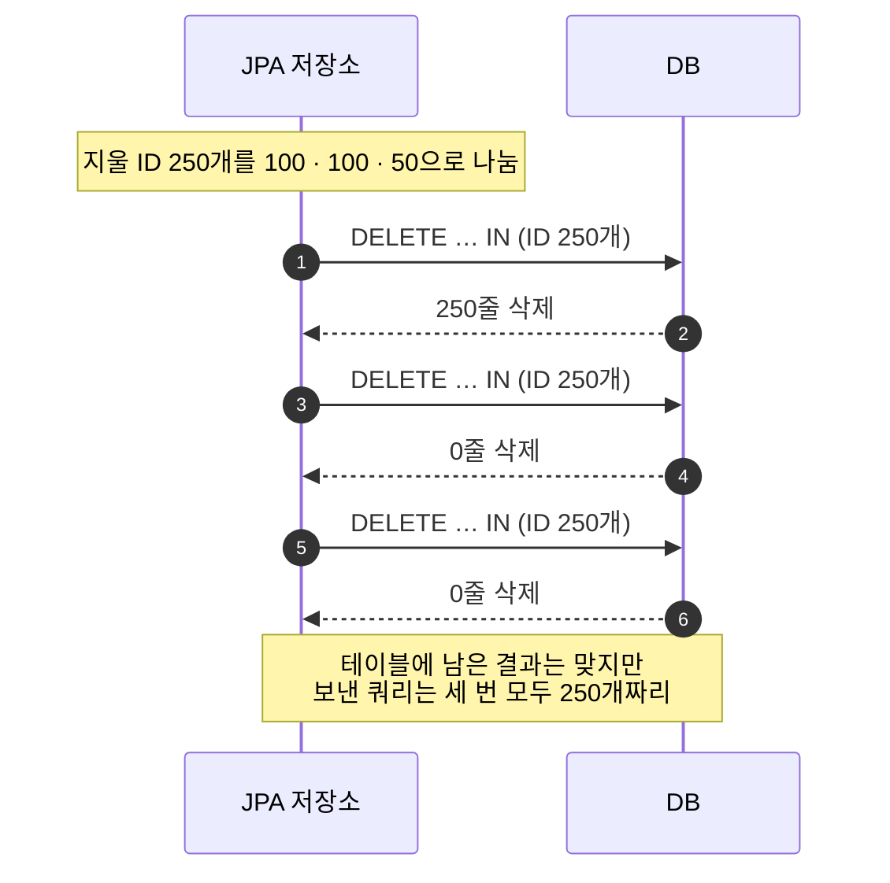
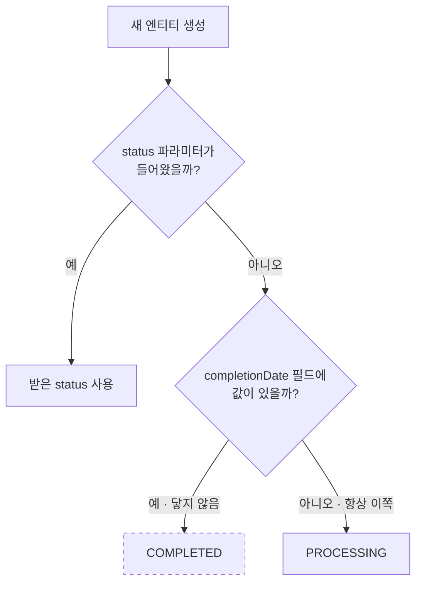
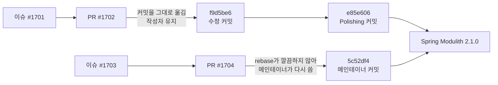
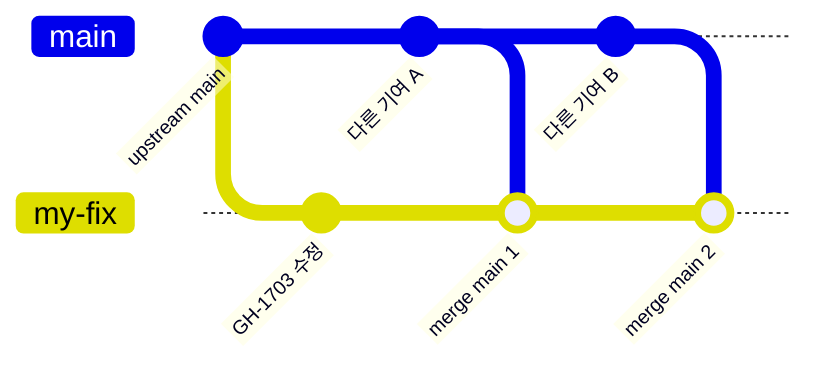

## 서론

Spring Modulith를 공부하면서 이벤트 저장소의 JPA 구현을 읽다가 고칠 곳 두 군데를 찾았습니다.

하나는 100개씩 나눠서 지우려던 DELETE가 매번 전체 목록을 보내고 있던 문제였고 다른 하나는 생성자 안에서 절대 실행되지 않는 분기였습니다. 둘 다 한 줄짜리 수정이었고 이슈와 PR을 거쳐 2026년 6월에 나온 Spring Modulith 2.1.0에 들어갔습니다.

이 글에서는 무엇을 찾았는지, 왜 테스트로는 드러나지 않았는지, 이슈와 PR은 어떻게 썼는지를 순서대로 정리했습니다. 두 PR이 모두 Closed로 끝났는데 코드는 어떻게 들어갔는지도 이어서 적었습니다.

## Event Publication Registry는 무엇을 기록할까

Spring Modulith는 Spring Boot 애플리케이션 하나를 여러 모듈로 나누고 모듈 사이의 경계를 검사해 주는 프로젝트입니다. 모듈끼리는 서로의 코드를 직접 부르기보다 이벤트로 잇는 경우가 많습니다.

이때 이벤트를 잃지 않게 해 주는 기능이 **Event Publication Registry**입니다. <a href="#ref-e1">[E1]</a> 저는 이 기능을 이벤트 발송 장부처럼 이해했습니다. 이벤트를 보낼 때마다 장부에 한 줄을 적고 받는 쪽이 일을 마치면 그 줄에 완료 표시를 합니다. 끝내 처리하지 못한 줄은 장부에 그대로 남아 있으니 나중에 다시 보낼 수 있습니다.



*그림 1. `event_publication` 테이블의 한 줄이 생기고 지워지기까지*

장부의 한 줄은 업무 데이터와 같은 트랜잭션 안에서 `event_publication` 테이블에 저장됩니다. 끝난 줄은 `CompletedEventPublications` API로 지울 수 있습니다. 완료를 어떻게 기록할지는 `CompletionMode`로 고를 수 있는데 기본값은 줄에 완료 표시를 남기는 `UPDATE`입니다. 이 글도 `UPDATE` 기준으로 설명합니다.

저장소 구현은 JPA, JDBC, MongoDB, Neo4j 네 가지가 있습니다. 이 글은 그중 JPA 구현을 다룹니다.

## 왜 JPA 저장소 소스까지 읽게 되었을까

Event Publication Registry를 제대로 쓰려면 장부의 한 줄이 언제 생기고 언제 상태가 바뀌고 언제 지워지는지 정확히 알아야 했습니다. 레퍼런스 문서는 기능을 잘 설명해 주지만 저장소가 DB에 실제로 어떤 쿼리를 보내는지까지 알려 주지는 않습니다. 그래서 JPA 구현인 `spring-modulith-events-jpa`부터 소스를 열어 봤습니다.

`JpaEventPublicationRepository`에는 줄을 저장하고 상태를 바꾸고 지우는 쿼리가 모여 있습니다. `JpaEventPublication`은 테이블 한 줄에 대응하는 JPA 엔티티입니다. 주로 이 두 파일을 읽었고 고칠 곳도 각 파일에서 하나씩 나왔습니다.

## 첫 번째 줄: 나눠 놓고 전체를 보내는 DELETE

### 코드는 어떻게 생겼을까

아래는 2.1.0 이전 코드에서 끝난 줄을 지우는 메서드입니다.

```java
private static final String DELETE = """
        delete
          from DefaultJpaEventPublication p
         where p.id in ?1
        """;

private static final int DELETE_BATCH_SIZE = 100;

public void deletePublications(List<UUID> identifiers) {

    batch(identifiers, DELETE_BATCH_SIZE).forEach(it -> {
        entityManager.createQuery(DELETE).setParameter(1, identifiers).executeUpdate();
    });
}
```

`batch(identifiers, 100)`은 ID 목록을 100개씩 잘라 묶음 목록으로 돌려줍니다. 잘린 묶음은 하나씩 람다의 `it`으로 들어옵니다. Kotlin을 쓰신다면 `it`이 익숙하실 텐데, 여기서는 Java 람다의 파라미터 이름을 `it`으로 지었을 뿐입니다.

문제는 그다음 줄입니다. 쿼리에 바인딩하는 값이 방금 받은 묶음 `it`이 아니라 원래 목록 `identifiers`입니다.

명단으로 비유하면 이렇습니다. 250명짜리 명단을 100명씩 세 장으로 나눠 놓고 정작 이름을 부를 때는 매번 원본 명단 250명을 처음부터 끝까지 읽는 셈입니다. 코드 기준으로 그려 보면 아래와 같습니다.

```text
identifiers             = [ ID 1 ················· ID 250 ]        ← 원래 목록
batch(identifiers, 100) = [ ID 1~100 ] [ ID 101~200 ] [ ID 201~250 ]
                               it            it             it      ← 람다가 받는 묶음

setParameter(1, identifiers) → 1회차 250개 / 2회차 250개 / 3회차 250개  (수정 전)
setParameter(1, it)          → 1회차 100개 / 2회차 100개 / 3회차  50개  (원래 의도)
```

*그림 2. 나눈 묶음(`it`)과 원래 목록(`identifiers`) 중 무엇을 바인딩했는가*

### 왜 테스트로는 드러나지 않았을까

이 메서드는 `CompletedEventPublications.deletePublications(filter)`를 부르면 실행됩니다. Registry는 끝난 줄을 모두 읽어 조건으로 거른 뒤, 남은 ID 목록을 그대로 저장소에 넘깁니다. 지울 줄이 많을수록 큰 목록이 넘어옵니다.

그런데 결과만 보면 문제가 없어 보입니다. 첫 번째 DELETE가 250줄을 전부 지우고 두 번째와 세 번째 DELETE에는 지울 줄이 남아 있지 않습니다.



*그림 3. 지운 결과가 같아서, 결과만 확인하는 테스트로는 잡히지 않는 이유*

DB를 띄우고 "다 지워졌는가"를 확인하는 테스트는 수정 전 코드로도 통과합니다. 지운 결과 자체는 맞기 때문입니다. DB로 나가는 쿼리 쪽이 문제였습니다.

### 결과가 맞는데 무엇이 문제였을까

- 100개씩 나눠 보내려던 의도와 달리, 큰 IN 목록이 그대로 DB로 갑니다.
- 그 큰 DELETE가 묶음 수만큼 반복됩니다. ID가 1,000개라면 1,000개짜리 DELETE가 열 번 나갑니다.
- 나눠 둔 의미가 없으니 목록이 아주 크면 DB나 드라이버의 바인딩 파라미터 상한에 걸릴 수 있습니다.

이 버그는 성능과 운영 안정성 쪽의 문제이고 데이터가 틀어지지는 않습니다. 뒤에서 이슈를 쓸 때도 이 구분을 분명히 하려고 했습니다.

### JDBC 구현과 나란히 놓고 보니 확신이 생겼습니다

제가 잘못 읽은 것은 아닌지 확인하려고 같은 메서드의 JDBC 구현을 열어 봤습니다.

```java
// JdbcEventPublicationRepository
batch(dbIdentifiers, DELETE_BATCH_SIZE)
        .forEach(it -> operations.update(sqlStatementDelete.concat(toParameterPlaceholders(it.length)), it));
```

JDBC 쪽은 묶음 `it`의 크기만큼 자리표시자를 만들고 값도 `it`을 그대로 넘기고 있었습니다. 같은 기능의 다른 구현이 묶음을 제대로 쓰고 있으니 JPA 쪽만 변수 하나를 잘못 쓴 것이라고 확신할 수 있었습니다.

이력을 따라가 보니 이 줄은 2023년 9월, `CompletedEventPublications` API가 처음 생길 때 들어온 뒤로 한 번도 바뀌지 않았습니다.

## 두 번째 줄: 닿을 수 없는 분기

### 생성자는 상태 기본값을 어떻게 고르고 있었을까

엔티티 생성자에서 상태 기본값을 정하는 줄부터 보겠습니다.

```java
protected @Nullable Instant completionDate;
protected @Enumerated(EnumType.STRING) Status status;

protected JpaEventPublication(UUID id, Instant publicationDate, String listenerId, String serializedEvent,
        Class<?> eventType, @Nullable Status status, @Nullable Instant lastResubmissionDate, int completionAttempts) {
    ...
    this.status = status != null ? status : completionDate != null ? Status.COMPLETED : Status.PROCESSING;
    ...
}
```

얼핏 보면 상태를 받지 못했을 때 완료 시각을 보고 `COMPLETED`나 `PROCESSING`을 고르는 코드처럼 보입니다. 그런데 `completionDate`는 생성자 파라미터가 아니라 필드입니다. 생성자 안에서 이 필드에 값을 넣는 코드가 없으니 이 줄이 실행되는 시점에는 항상 `null`로 남아 있습니다.



*그림 4. 점선으로 그린 `COMPLETED` 분기는 생성자 안에서 한 번도 실행되지 않습니다*

객체가 만들어지는 순서로 따라가 보면 더 분명합니다.

```text
new DefaultJpaEventPublication(...)
  1. completionDate = null                            ← 필드는 기본값으로 시작합니다
  2. this.id = id; this.listenerId = listenerId; ...  ← 생성자 본문이 위에서부터 실행됩니다
  3. completionDate != null  -> false                 ← 상태 기본값을 고를 때 이 조건은 항상 false입니다
  4. result.completionDate = instant;                 ← 완료 시각은 생성자가 끝난 뒤에야 들어옵니다 (archive() 기준)
```

*그림 5. 생성자가 도는 동안 `completionDate`를 채우는 코드는 없습니다*

실제로 아카이브용 엔티티를 만드는 `archive()`도 생성자에 `Status.COMPLETED`를 직접 넘기고 완료 시각은 생성자 호출이 끝난 다음 줄에서 넣습니다. DB에서 엔티티를 읽어 올 때는 JPA가 이 생성자 대신 기본 생성자를 쓰고 필드를 직접 채우니, 이 분기를 탈 기회는 더더욱 없습니다.

### 동작이 같은데 왜 고쳐야 했을까

결국 이 줄은 `status != null ? status : Status.PROCESSING`과 똑같이 동작합니다. 고쳐도 런타임 동작은 바뀌지 않습니다.

다만 읽는 사람은 "완료 시각이 있으면 완료 상태로 만든다"고 오해하기 쉽습니다. 실제로 끝난 줄은 생성자 밖의 `markCompleted` 같은 완료 처리 경로를 거쳐 `COMPLETED`가 됩니다. 저처럼 저장소 동작을 이해하려고 소스를 읽는 사람에게는 이런 분기가 잘못된 지도 역할을 합니다.

## 이슈는 어떻게 썼을까

두 가지를 따로 이슈로 올렸습니다. 2026년 5월 20일에 올린 [#1701](https://github.com/spring-projects/spring-modulith/issues/1701)(DELETE 배치)과 [#1703](https://github.com/spring-projects/spring-modulith/issues/1703)(상태 기본값)입니다. 두 이슈 모두 본문을 같은 틀로 썼습니다.

| 구분 | 적은 내용 |
| --- | --- |
| Problem | 어떤 코드가 어떻게 동작하는지 적었습니다. #1701은 ID 250개 예시로 기대 동작과 실제 동작을 나란히 보였습니다 |
| Impact | 무엇이 문제이고 무엇은 문제가 아닌지 적었습니다. #1701은 "데이터 정합성 버그가 아니라 성능·운영 안정성 문제", #1703은 "런타임 동작은 바뀌지 않는다"고 적었습니다 |
| Proposed Fix | 바꿀 코드를 그대로 붙였습니다 |

*표 1. 두 이슈에 공통으로 쓴 본문 구성*

영향을 부풀리지 않으려고 가장 신경 썼습니다. 메인테이너는 이슈를 보고 우선순위를 판단합니다. 실제보다 크게 쓴 이슈는 그 판단을 오히려 방해한다고 생각했습니다.

## PR #1702: 한 줄짜리 수정을 테스트로 어떻게 증명할까

[PR #1702](https://github.com/spring-projects/spring-modulith/pull/1702)에서는 변수 하나만 수정했습니다.

```diff
 batch(identifiers, DELETE_BATCH_SIZE).forEach(it -> {
-    entityManager.createQuery(DELETE).setParameter(1, identifiers).executeUpdate();
+    entityManager.createQuery(DELETE).setParameter(1, it).executeUpdate();
 });
```

수정보다 테스트 쪽을 더 고민했습니다. 앞에서 본 것처럼 이 버그는 지운 결과가 같아서 DB를 띄우는 통합 테스트로는 잡히지 않습니다. 확인해야 하는 것은 "몇 줄이 지워졌는가"가 아니라 "쿼리에 무엇이 바인딩됐는가"였습니다.

그래서 `EntityManager`와 `Query`를 mock으로 두고 `setParameter`로 들어온 목록을 모아 크기를 확인하는 단위 테스트를 새로 만들었습니다.

```java
@Test
void deletesPublicationsByIdentifierInBatches() {

    var entityManager = mock(EntityManager.class);
    var query = mock(Query.class);
    var parameters = new ArrayList<List<UUID>>();

    when(entityManager.createQuery(anyString())).thenReturn(query);
    when(query.setParameter(eq(1), any())).thenAnswer(invocation -> {

        parameters.add(invocation.getArgument(1));
        return query;
    });

    var repository = new JpaEventPublicationRepository(entityManager, mock(EventSerializer.class),
            CompletionMode.UPDATE);
    var identifiers = new ArrayList<UUID>();

    for (var i = 0; i < 101; i++) {
        identifiers.add(UUID.randomUUID());
    }

    repository.deletePublications(identifiers);

    verify(query, times(2)).executeUpdate();

    assertThat(parameters).extracting(List::size).containsExactly(100, 1);
}
```

101개는 100개 묶음 경계를 딱 하나 넘기는 숫자라 두 번째 묶음에 ID가 1개만 남습니다. 그래서 DELETE가 두 번 실행되고 바인딩된 목록 크기가 100과 1이어야 합니다. 수정 전 코드에서는 101과 101이 바인딩되어 실패합니다.

테스트 위치도 고민했습니다. 기존 통합 테스트 클래스(`JpaEventPublicationRepositoryIntegrationTests`)에 mock 검증을 섞지 않고 `JpaEventPublicationRepositoryUnitTests`를 따로 만들었습니다. 저장소에서 쓰던 테스트 관례에 맞추려고 했습니다.

## PR #1704: 동작이 같은 정리에는 무엇을 붙였을까

[PR #1704](https://github.com/spring-projects/spring-modulith/pull/1704)는 닿지 않는 분기를 지웠습니다.

```diff
-this.status = status != null ? status : completionDate != null ? Status.COMPLETED : Status.PROCESSING;
+this.status = status != null ? status : Status.PROCESSING;
```

동작이 같은 정리라서 새 테스트는 붙이지 않았습니다.

## 두 PR은 Closed인데 코드는 어떻게 들어갔을까

둘 다 2026년 6월 11일에 나온 2.1.0에 들어갔습니다. <a href="#ref-e2">[E2]</a> 그런데 GitHub에서 두 PR을 열어 보면 Merged가 아니라 Closed로 남아 있습니다.

Spring Modulith는 PR을 머지 버튼으로 받지 않습니다. 메인테이너가 커밋을 main으로 직접 옮기거나 내용을 참고해 다시 씁니다. 그래서 반영 여부는 PR 상태로는 알 수 없고 이슈에 달린 답변과 main의 커밋으로 확인해야 합니다.



*그림 6. 두 PR이 main에 들어간 두 가지 경로*

|  | #1701 / PR #1702 | #1703 / PR #1704 |
| --- | --- | --- |
| 메인테이너 답변 | "That's applied, thanks!" | PR 브랜치가 main에 깔끔하게 rebase되지 않아 직접 적용했고, 자신의 커밋을 PR에 연결해 두었다는 답변 |
| 들어간 커밋 | [`f9d5be6`](https://github.com/spring-projects/spring-modulith/commit/f9d5be69cb64187da1fdf7ce9af4a985cd56f3d1). 작성자가 저 그대로이고, 뒤이어 Polishing 커밋 [`e85e606`](https://github.com/spring-projects/spring-modulith/commit/e85e6063d48e4e645d7fc38ca515488cf05c3da2)이 붙었습니다 | [`5c52df4`](https://github.com/spring-projects/spring-modulith/commit/5c52df49057a20dcc62d2e1ddfb954308e45aa07). 메인테이너가 다시 썼고, 커밋 메시지에 "Inspired by @char-yb's contribution."이 붙었습니다 |
| PR 상태 | Closed | Closed |

*표 2. 두 기여가 반영된 방식 비교*

### 메인테이너는 무엇을 더 다듬었을까

#1701의 Polishing 커밋은 테스트를 조금 손봤습니다. `for` 루프를 `IntStream`으로 바꾸고 `@Test` 옆에 이슈 번호를 주석으로 달았습니다.

```java
@Test // GH-1701
void deletesPublicationsByIdentifierInBatches() {
    ...
    IntStream.range(0, 101)
            .mapToObj(__ -> UUID.randomUUID())
            .forEach(identifiers::add);
    ...
}
```

테스트에 이슈 번호를 남기는 것은 이 저장소의 관례였습니다. `spring-modulith-events` 아래에서만 `@Test // GH-` 형태가 300개 가까이 됩니다. 이후 기여에서는 저도 처음부터 이 형태로 맞춰 올렸습니다.

#1703을 반영할 때는 커밋 제목을 "Simplify legacy schema status defaulting for JPA event publications"로 달고 `status` 필드에 `@Nullable`을 붙였습니다.

```diff
-protected @Enumerated(EnumType.STRING) Status status;
+protected @Nullable @Enumerated(EnumType.STRING) Status status;
```

상태 칸이 비어 있는 줄이 있을 수 있다는 점까지 코드에 드러낸 것입니다. 제가 고친 범위보다 한 걸음 더 나간 정리였습니다.

### #1704는 왜 그대로 쓰이지 못했을까

제 브랜치에 원인이 있었습니다. 작업하는 동안 main을 여러 번 merge했더니 PR 커밋 목록에 다른 사람의 커밋과 merge 커밋이 잔뜩 섞였습니다.



*그림 7. 작업 중에 main을 merge한 PR 브랜치. 수정 커밋 하나에 merge 커밋이 계속 덧붙습니다*

같은 때 낸 다른 PR [#1700](https://github.com/spring-projects/spring-modulith/pull/1700)도 같은 상태였고 거기서는 이런 댓글을 받았습니다.

> I can't really use these PRs as they're littered with merge commits, which we don't use. Please make sure you only submit commits (ideally one) that apply cleanly on some commit on the target branch.

merge 커밋이 잔뜩 섞인 PR은 쓸 수 없으니 대상 브랜치에 깔끔하게 올라가는 커밋을, 가능하면 하나만 보내 달라는 이야기였습니다. #1702도 merge 커밋이 섞여 있긴 했지만 수정 커밋만큼은 작성자가 유지된 채 옮겨졌습니다.

## 결론

Spring Modulith의 Event Publication Registry를 이해하려고 JPA 저장소 소스를 읽다가 두 가지를 찾았습니다. DELETE는 100개씩 나눠 놓고도 매번 전체 목록을 바인딩했고 생성자에는 절대 닿지 않는 분기가 있었습니다. 각각 이슈와 PR로 올렸고 둘 다 2.1.0에 반영됐습니다.

|  | 수정 전 | 수정 후 |
| --- | --- | --- |
| ID 250개 삭제 | 250개짜리 DELETE를 세 번 보냅니다 | 100, 100, 50개씩 세 번 보냅니다 |
| 상태 기본값 | 닿지 않는 `COMPLETED` 분기가 있습니다 | `PROCESSING` 하나로 읽힙니다 |

*표 3. 두 수정의 전후 비교*

이번 기여에서 얻은 것은 세 가지입니다.

- **결과가 맞아도 버그일 수 있습니다.** DELETE 버그는 지운 결과가 같아서 테스트로는 드러나지 않았습니다. 소스를 읽어야 보였습니다. 그래서 테스트도 결과 대신 바인딩된 값을 확인하도록 썼습니다.
- **같은 기능의 다른 구현과 비교하면 빨리 확신할 수 있습니다.** JDBC 구현이 묶음을 제대로 바인딩하는 것을 보고 JPA 쪽이 의도와 다르다는 것을 확신했습니다.
- **PR은 내용만큼 모양도 중요합니다.** 내용은 둘 다 받아들여졌지만 merge 커밋이 섞인 PR은 그대로 쓰이지 못했습니다. 그 뒤로는 작업 중에 main을 merge하지 않고 upstream main 바로 위에 커밋 하나만 올립니다.

마지막 교훈은 다음 기여에서 바로 효과를 봤습니다. 몇 달 뒤 개인 프로젝트에서 이벤트 재전송 버그([#1925](https://github.com/spring-projects/spring-modulith/issues/1925))를 찾아 PR을 냈을 때는 커밋 하나로 올렸고 그 커밋이 수정 없이 main과 두 유지보수 브랜치에 들어갔습니다. 그 이야기는 다음 글에서 정리해 보겠습니다.

## References

### Project References

- <span id="ref-p1">[P1]</span> [Issue #1701: Fix JPA event publication delete batching to bind each batch](https://github.com/spring-projects/spring-modulith/issues/1701), [PR #1702: GH-1701 - Fix JPA event publication delete batching](https://github.com/spring-projects/spring-modulith/pull/1702)
- <span id="ref-p2">[P2]</span> [Commit f9d5be6: GH-1701 - Fix JPA event publication delete batching](https://github.com/spring-projects/spring-modulith/commit/f9d5be69cb64187da1fdf7ce9af4a985cd56f3d1), [Commit e85e606: GH-1701 - Polishing](https://github.com/spring-projects/spring-modulith/commit/e85e6063d48e4e645d7fc38ca515488cf05c3da2)
- <span id="ref-p3">[P3]</span> [Issue #1703: Simplify default status assignment in JpaEventPublication](https://github.com/spring-projects/spring-modulith/issues/1703), [PR #1704: GH-1703 - Simplify JPA publication status defaulting](https://github.com/spring-projects/spring-modulith/pull/1704)
- <span id="ref-p4">[P4]</span> [Commit 5c52df4: GH-1703 - Simplify legacy schema status defaulting for JPA event publications](https://github.com/spring-projects/spring-modulith/commit/5c52df49057a20dcc62d2e1ddfb954308e45aa07)

### External References

- <span id="ref-e1">[E1]</span> [Spring Modulith Reference: Working with Application Events](https://docs.spring.io/spring-modulith/reference/events.html)
- <span id="ref-e2">[E2]</span> [Spring Modulith Releases: 2.1.0](https://github.com/spring-projects/spring-modulith/releases/tag/2.1.0)
