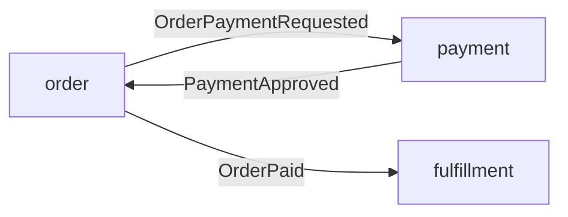
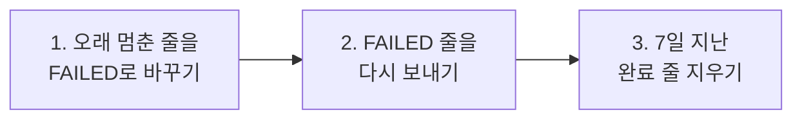

## 서론

개인 프로젝트 ResilientPOS에서 이벤트 재전송 기능을 만들다가 Spring Modulith의 버그를 찾았습니다. 이미 처리를 마친 이벤트가 한 번 더 나가거나 실패한 것으로 되돌아가는 버그였습니다.


*그림 1. 택배는 이미 문 앞에 도착했는데 장부의 그 줄에 재발송 도장을 또 찍는 상황입니다*

고친 방법은 SQL 조건 한 줄이었습니다. 이 수정은 Spring Modulith 2.2.0-RC1, 2.1.2, 2.0.9에 들어갑니다. <a href="#ref-p2">[P2]</a>

이 글에서는 버그를 어떻게 찾았는지, 왜 생기는지, 어떻게 고쳤는지, 고친 뒤 프로젝트에서 무엇을 걷어냈는지를 순서대로 정리했습니다.

## ResilientPOS는 어떤 프로젝트일까

ResilientPOS는 매장에서 쓰는 POS(판매 시점 관리) 시스템의 백엔드입니다. 목표는 한 문장입니다. **네트워크가 끊기거나 일부가 실패해도 주문과 결제 상태가 중복 없이 맞아야 합니다.**

- **기술 스택:** Kotlin, Spring Boot 4.1.1, Spring Modulith 2.1.1, PostgreSQL, Kafka, Redis
- **구조:** 하나로 배포하되 안을 모듈로 나눈 모듈러 모놀리스입니다. 모듈 경계는 Spring Modulith가 검사합니다.
- **모듈 사이 연결:** 주문(`order`), 결제(`payment`), 주문 이행(`fulfillment`) 모듈은 서로의 코드를 직접 부르지 않고 Kafka 이벤트로 이어집니다.



*그림 2. 주문, 결제, 주문 이행 모듈을 잇는 이벤트*

이 구조에서는 이벤트 하나가 곧 업무 한 단계입니다. 이벤트가 빠지면 돈은 받았는데 주문이 다음 단계로 넘어가지 않습니다. 같은 이벤트가 두 번 가면 받는 쪽이 같은 일을 두 번 할 수 있습니다.

모든 consumer는 같은 메시지를 두 번 받아도 결과가 같도록(멱등) 만들었습니다. 이벤트를 잃지 않는 일은 Spring Modulith의 Event Publication Registry에 맡겼습니다.

## Event Publication Registry는 무엇을 남길까

[지난 글](/tech-blog/20261020_spring_modulith_jpa_repository)에서처럼 이 기능을 이벤트 발송 장부로 생각하면 쉽습니다. 이벤트를 발행하면 업무 데이터와 같은 트랜잭션 안에서 `event_publication` 테이블에 한 줄이 생깁니다. <a href="#ref-e1">[E1]</a> Kafka가 잠깐 죽어도 이 줄이 남아 있으니 나중에 다시 보낼 수 있습니다.

이 글에서 중요한 칸은 상태(`status`)와 완료 시각(`completion_date`) 두 개뿐입니다.


*그림 3. 장부 한 줄에서 이 글이 다루는 두 칸*

이 글에서는 상태 칸의 값을 바꾸는 일을 "도장을 찍는다"고 부르겠습니다. 완료 시각 칸에 시각이 적혀 있으면 이미 끝난 일입니다.

ResilientPOS는 완료 모드를 `UPDATE`로 둡니다. 처리가 끝난 줄을 지우지 않고 `COMPLETED`로 바꿔 남기는 방식이고 남은 줄은 7일 뒤에 따로 지웁니다.

뒤에서 다룰 버그는 이 모드에서만 생깁니다. `DELETE`와 `ARCHIVE` 모드는 끝난 줄을 테이블에서 빼기 때문입니다.

## 재전송 작업은 어떻게 만들었을까

Kafka가 죽어 있는 동안 보내지 못한 이벤트는 장부에 `FAILED`로 남습니다. Modulith가 장부를 남겨 주기는 하지만 그 줄을 언제 어떻게 다시 보낼지는 애플리케이션이 정해야 합니다. 그래서 매분 도는 재전송 작업(`EventPublicationResubmitter`)을 만들었습니다.



*그림 4. 재전송 작업의 한 주기. 2단계는 Modulith의 `FailedEventPublications.resubmit`을 부릅니다*

만들기 전에 Modulith 2.1.1 소스를 읽었습니다. 공식 문서는 시각을 무엇으로 재는지, 끝난 줄을 어떻게 다루는지까지는 알려 주지 않았습니다. 소스를 보니 그대로 믿고 쓰기 어려운 곳이 있어서 세 군데를 우회했습니다.

### staleness monitor를 껐습니다

Modulith에는 멈춘 줄을 `FAILED`로 바꿔 주는 감시 작업(staleness monitor)이 있는데 2.1.1의 monitor에는 문제가 두 가지 있었습니다.

- 방금 다시 보낸 줄도 최초 발행 시각으로 쟀습니다. <a href="#ref-p3">[P3]</a> 오래된 이벤트는 다시 보내자마자 또 `FAILED`가 될 수 있었습니다.
- 상태로 줄을 고른 뒤 ID로 `FAILED`를 찍었습니다. 고른 뒤 찍기 전에 끝난 줄도 `FAILED`로 덮였습니다.

그래서 monitor를 끄고 끝나지 않은 줄만 마지막 시도 시각으로 재는 UPDATE를 직접 썼습니다.

### 완료 줄을 정리하는 UPDATE를 하나 더 넣었습니다

"처리는 끝났는데 상태만 `RESUBMITTED`로 남은 줄"이 재전송 자리를 차지할 수 있다고 봤습니다. Modulith는 동시에 재전송 중인 건수(`maxInFlight`)를 `RESUBMITTED` 줄 수로 세기 때문입니다.

### Redis 락으로 서버 사이에 순서를 정했습니다

재전송 작업이 서버마다 돌기 때문에 한 번에 한 서버만 보내도록 락을 걸었습니다. 이 락은 fail-open이라 Redis가 죽으면 락 없이 그냥 돕니다. 그때 생기는 중복은 멱등 consumer가 견디도록 했습니다.

1단계 코드는 다음과 같습니다. 두 번째 문장이 정리용 UPDATE입니다.

```kotlin
internal fun markStalePublicationsFailed() {
    jdbcTemplate.update(
        """
        update event_publication set status = 'FAILED'
        where completion_date is null
          and status in ('PUBLISHED', 'PROCESSING', 'RESUBMITTED')
          and coalesce(last_resubmission_date, publication_date) < ?
        """.trimIndent(),
        Timestamp.from(clock.instant().minus(staleAfter)),
    )
    jdbcTemplate.update("update event_publication set status = 'COMPLETED' where status = 'RESUBMITTED' and completion_date is not null")
}
```

기능은 이렇게 완성됐습니다. 그런데 우회 코드에는 제가 Modulith의 동작을 어떻게 이해했는지가 그대로 담겨 있었고 그 이해에 틀린 곳이 있었습니다.

## 우회 코드의 이유는 어디가 틀렸을까

처음부터 기여할 생각은 아니었습니다. 계기는 다른 데서 왔습니다.

`spring-modulith-bom` 2.1.1의 CVE를 해결해 달라는 요청을 조사했는데 Modulith 자체에는 CVE가 없었습니다. 취약한 것은 Spring Boot가 끌어오는 Tomcat, Jackson, lz4였고 버전을 올려서 끝냈습니다. 그러고 나니 "그럼 내가 Modulith에 직접 기여할 부분은 없을까?"라는 질문이 남았습니다.

후보는 재전송 작업을 만들며 우회했던 문제들이었습니다. 그중 하나로 다른 이슈에 남길 댓글을 쓰다가 <a href="#ref-p4">[P4]</a> 정리용 UPDATE를 넣은 이유를 소스로 다시 확인했습니다. "끝났는데 `RESUBMITTED`로 남은 줄이 재전송 자리를 차지한다"는 설명이었습니다.

이 설명은 틀렸습니다.

- 다시 보낸 줄은 전송이 끝나면 ID로 완료 표시를 받습니다(`MARK_COMPLETED_BY_ID`).
- 이 UPDATE는 조건 없이 `status`를 `COMPLETED`로, `completion_date`를 지금 시각으로 바꿉니다.
- 그래서 정상 경로에서는 "끝났는데 `RESUBMITTED`"인 줄이 남지 않습니다.

그렇다면 그런 줄은 언제 생길까요? 이미 끝난 줄에 재전송 도장이 찍혀야 생깁니다. 설마 하고 재전송 표시 SQL을 열어 봤더니 정말 그 조건이 없었습니다.

## 왜 끝난 줄에 도장이 다시 찍힐까

Modulith 2.1.1의 JPA 저장소에서 상태를 바꾸는 SQL은 두 개입니다.

```java
// markFailed(UUID), markProcessing(UUID)가 같이 쓴다
update DefaultJpaEventPublication p
   set p.status = ?1
 where p.id = ?2
   and (status is null or status != ?1)

// markResubmitted(UUID, Instant)
update DefaultJpaEventPublication p
   set p.status = RESUBMITTED,
       p.completionAttempts = p.completionAttempts + 1,
       p.lastResubmissionDate = ?1
 where p.id = ?2
   and (p.status is null or p.status != RESUBMITTED)
```

둘 다 규칙이 하나뿐입니다. **"이 도장이 아직 없으면 찍는다."** 그 사이에 처리가 끝났는지, 즉 완료 시각 칸이 채워졌는지는 보지 않아서 두 가지 사고가 납니다.

### 사고 1. 재전송이 끝난 줄을 다시 가져갑니다

재전송은 `FAILED` 줄을 먼저 읽고 한 줄씩 재전송 도장을 찍은 뒤 보냅니다. 읽은 뒤 도장을 찍기 전에 그 줄이 끝나도 도장은 찍힙니다.


*그림 5. 직원 둘이 장부 하나를 같이 쓰면 생기는 일. 왼쪽 직원은 아까 읽은 목록만 보고 도장을 찍습니다*

장부로 옮기면 7번 줄은 이렇게 바뀝니다.


*그림 6. 두 서버가 거의 동시에 재전송을 돌릴 때 7번 줄에 일어나는 일*

- 같은 이벤트가 Kafka로 두 번 나갑니다. ResilientPOS에서는 Redis 락이 빠졌을 때(Redis 장애, 락 시간 초과) 이렇게 됩니다.
- 완료 시각이 두 번째 전송 시각으로 덮이고 7일 뒤 지우는 날짜도 같이 밀립니다.
- 서버가 한 대여도 생깁니다. 느린 리스너가 멈춘 줄로 잡혀 `FAILED`가 되고 재전송이 그 줄을 읽은 뒤 원래 실행이 끝나면 같은 모양이 됩니다.
- 09:00:02와 09:00:03 사이에 서버 A가 죽으면 7번은 "끝났는데 `RESUBMITTED`"로 남습니다. **제가 넣은 정리용 UPDATE가 치우던 줄이 바로 이것이었습니다.** 이유는 틀리게 적었지만 실제로는 이 버그의 뒷정리를 하고 있었던 셈입니다.

### 사고 2. 끝난 줄이 `FAILED`로 돌아갑니다

재전송 작업을 만들 때 monitor에서 이미 본 문제입니다. 그때는 monitor를 꺼서 피했는데 원인은 monitor가 아니라 위의 첫 번째 SQL에 있었습니다. monitor를 꺼도 다시 보낸 전송이 실패하는 경로(`markFailed`)에서는 똑같이 생깁니다.


*그림 7. monitor가 고른 줄이 그 사이에 끝났을 때 9번 줄에 일어나는 일*

- 완료 시각이 있는데 상태는 `FAILED`입니다. 장부의 앞뒤가 맞지 않습니다.
- 실패 목록 조회는 `FAILED`이기만 하면 읽으니 9번은 다음 주기에 한 번 더 나갑니다.
- 사고 1에서 두 번째 전송이 실패해도 같은 모양이 됩니다.

두 사고를 모아 보면 끝난 줄에 도장이 다시 찍혔을 때 세 가지 일이 생깁니다.


*그림 8. 끝난 줄에 도장이 다시 찍히면 생기는 일*

원인이 Modulith 저장소의 SQL에 있으니 monitor를 끄고 정리용 UPDATE를 더해도 증상만 치울 뿐이었습니다. `UPDATE` 완료 모드로 JPA, JDBC, Neo4j 저장소를 쓰는 다른 사용자도 같은 문제를 겪습니다. 그래서 우리 쪽 우회를 늘리는 대신 업스트림을 고치기로 했습니다.

## 어떻게 재현하고 고쳤을까

### 재현 테스트부터 썼습니다

이슈를 올리기 전에 Modulith를 클론해서 저장소 수준 테스트 두 개를 썼습니다. 끝난 줄에 재전송 도장과 실패 도장을 찍어 보는 테스트입니다.

```java
@Test // GH-1925
void doesNotResubmitCompletedPublication() {

	var publication = createPublication(new TestEvent("completed"));

	repository.markCompleted(publication.getIdentifier(), Instant.now());
	em.flush();
	em.clear();

	assertThat(repository.markResubmitted(publication.getIdentifier(), Instant.now())).isFalse();
}

@Test // GH-1925
void doesNotMarkCompletedPublicationFailed() {

	var publication = createPublication(new TestEvent("completed"));

	repository.markCompleted(publication.getIdentifier(), Instant.now());
	em.flush();
	em.clear();

	repository.markFailed(publication.getIdentifier());
	em.clear();

	assertThat(repository.findByStatus(Status.FAILED)).isEmpty();
}
```

- main에서 두 테스트 모두 `UPDATE` 모드일 때만 실패했습니다. `DELETE`와 `ARCHIVE` 모드는 끝난 줄이 테이블에 없어서 통과했습니다.
- 두 SQL에 `completionDate is null` 한 줄을 더하니 통과했고 JPA 모듈의 나머지 테스트도 그대로 통과했습니다.
- 비슷한 제보가 있는지 찾아봤는데 없었습니다. 2026년 10월 6일에 [#1925](https://github.com/spring-projects/spring-modulith/issues/1925)로 올리면서 재현 테스트와 수정안을 본문에 같이 적었습니다. <a href="#ref-p1">[P1]</a>

이슈 본문에는 실수가 하나 있었습니다. "MongoDB와 Neo4j도 같아 보인다"고 적었는데 다음 날 확인해 보니 MongoDB에는 이미 같은 조건과 회귀 테스트가 있었습니다. <a href="#ref-p5">[P5]</a> 본문을 바로 고쳤고 그 점을 오히려 "나머지 저장소를 MongoDB에 맞춘다"는 근거로 썼습니다.

### 조건 한 줄을 더했습니다

고친 방법은 단순합니다. 도장을 찍기 전에 완료 시각 칸부터 봅니다.


*그림 9. 완료 시각이 적혀 있으면 재발송 도장을 찍지 않습니다*

규칙으로 옮기면 조건 하나가 더해집니다.


*그림 10. 상태를 바꾸는 규칙의 전후*

[PR #1926](https://github.com/spring-projects/spring-modulith/pull/1926)에서 JPA, JDBC, Neo4j 저장소의 두 SQL에 같은 조건을 더했습니다. JPA 쪽 변경은 이것이 전부입니다.

```diff
 update DefaultJpaEventPublication p
    set p.status = ?1
  where p.id = ?2
+   and p.completionDate is null
    and (status is null or status != ?1)

 update DefaultJpaEventPublication p
    set p.status = RESUBMITTED, ...
  where p.id = ?2
+   and p.completionDate is null
    and (p.status is null or p.status != RESUBMITTED)
```

- 확인과 도장을 한 문장 안에서 합니다. 따로 읽고 쓰면 그 틈에 또 바뀔 수 있습니다. 서버 사이 락 없이 조건만으로 막을 수 있습니다.
- 첫 번째 SQL은 `markProcessing`도 같이 써서 끝난 줄이 `PROCESSING`으로 돌아가는 일도 함께 막힙니다.
- 저장소마다 위 테스트 두 개를 붙였습니다.

검증은 이렇게 했습니다.

- 수정 뒤에는 JPA 87개, Neo4j 78개 테스트가 통과했습니다. JDBC는 H2, HSQLDB, MySQL, MariaDB, PostgreSQL, Oracle, SQL Server 일곱 DB에서 837개가 통과했습니다.
- 수정을 되돌리면 `UPDATE` 모드에서 새 테스트만 실패했습니다.
- PR의 CI 빌드와 DCO 검사(커밋에 `Signed-off-by`가 있는지)도 통과했습니다.

## 고치면 결과가 어떻게 달라질까

`UPDATE` 모드에서 이미 완료된 7번 줄에 재전송 도장을 찍어 보면 장부가 이렇게 달라집니다.


*그림 11. 완료된 줄에 재발송 도장을 찍어 본 결과*

재전송, 실패, 처리 중 도장을 모두 시도해 보면 다음과 같습니다.

| 무엇을 보나 | 고치기 전 | 고친 뒤 |
| --- | --- | --- |
| 재전송 표시 결과 `markResubmitted` | `true`, 도장이 찍힙니다 | `false`, 건너뜁니다 |
| 상태 | 재전송 중, 실패, 처리 중 가운데 마지막에 찍힌 것 | `COMPLETED` 그대로 |
| 시도 횟수 `completion_attempts` | 1 늘어납니다 | 그대로입니다 |
| 실패 목록 조회 `findByStatus(FAILED)` | 7번이 들어 있습니다 | 비어 있습니다 |
| 리스너 호출 | 2번 | 1번 |
| 완료 시각 `completion_date` | 두 번째 전송 시각으로 덮입니다 | 처음 완료한 시각 그대로입니다 |

*표 1. 완료된 줄에 상태 변경을 시도했을 때의 전후 비교*

## 어디에 반영됐을까

2026년 10월 9일에 메인테이너가 PR을 적용하고 2.1.x와 2.0.x로 backport했습니다. 이슈에는 "That's fixed by applying your PR."라는 답이 달렸습니다.

| 브랜치 | 이슈 | 커밋 | 들어갈 버전 |
| --- | --- | --- | --- |
| main | [GH-1925](https://github.com/spring-projects/spring-modulith/issues/1925) | [`01ccfc2`](https://github.com/spring-projects/spring-modulith/commit/01ccfc23c877248615bcbe7c5e317f290ae810cc) | 2.2.0-RC1 |
| 2.1.x | [GH-1935](https://github.com/spring-projects/spring-modulith/issues/1935) | [`b354b8a`](https://github.com/spring-projects/spring-modulith/commit/b354b8a0e8b6b2ee72dee84b6c9e7df93bee3fa8) | 2.1.2 |
| 2.0.x | [GH-1936](https://github.com/spring-projects/spring-modulith/issues/1936) | [`d715b63`](https://github.com/spring-projects/spring-modulith/commit/d715b6318790153a628e77f81922df04406fa42a) | 2.0.9 |

*표 2. 수정이 들어간 브랜치와 버전*

세 버전은 2026년 10월 20일 현재 Maven Central에 아직 없습니다. GitHub 마일스톤의 목표일은 10월 22일이지만 확정된 날짜는 아니라서 밀릴 수 있습니다.

## 기여 뒤 ResilientPOS에서는 무엇을 바꿨을까

2.1.2에는 이번 수정과 함께 staleness monitor가 마지막 재전송 시각으로 재도록 고친 backport도 들어 있습니다. <a href="#ref-p3">[P3]</a> 처음에 넣은 우회 코드 세 개를 하나씩 다시 보니 결과는 셋 다 달랐습니다.

### 정리용 UPDATE는 지웠습니다

"끝났는데 `RESUBMITTED`"인 줄은 끝난 줄에 재전송 도장이 찍혀야 생깁니다. 2.1.2는 그 도장을 거절하고 완료 표시는 상태와 완료 시각을 함께 쓰니 그 줄이 생길 길이 없습니다.

```diff
         Timestamp.from(clock.instant().minus(staleAfter)),
     )
-    jdbcTemplate.update("update event_publication set status = 'COMPLETED' where status = 'RESUBMITTED' and completion_date is not null")
 }
```

- 2.1.1 때 이미 남은 줄은 7일 정리 단계가 지웁니다. 정리 DELETE는 `completion_date`만 보고 상태는 보지 않습니다.
- 통합 테스트에서도 그 상태를 일부러 만들던 줄을 뺐습니다. 2.1.2에서는 생기지 않는 상태이고 업스트림 테스트가 이미 그 동작을 지킵니다.

### staleness monitor는 계속 꺼 두고 이유만 바꿨습니다

처음에 monitor를 끈 이유였던 두 결함(#1836, #1925)은 2.1.2에서 고쳐졌지만 켜지 않았습니다. 이제 이유는 결함이 아니라 비용입니다.

- monitor는 상태마다 그 상태의 줄을 직렬화된 이벤트까지 전부 읽은 다음 메모리에서 시각으로 거르고 한 줄씩 UPDATE합니다. 이 일을 서버마다 1분마다 합니다.
- Kafka가 죽어 있으면 최근 5분(멈춤 판정 기간) 동안 들어온 전송 대기 줄이 매번 모두 읽힙니다.
- 직접 쓴 UPDATE는 조건을 건 한 문장입니다.

이 비용은 소스를 보고 추론한 것이고 실측하지는 않았습니다.

### 락은 그대로 두고 설명을 고쳤습니다

2.1.2에서는 다른 서버가 이미 끝낸 줄이 다시 나가지 않아 사고 1이 막혔습니다. 그러면 락이 필요 없지 않을까 싶었는데 리뷰에서 남은 틈이 하나 나왔습니다.

- 재전송 도장을 찍은 직후, Modulith는 리스너를 부르기 전에 그 줄을 `PROCESSING`으로 바꿉니다.
- 재전송 도장의 조건은 "`RESUBMITTED`가 아니고 끝나지 않았다"입니다. `PROCESSING`인 줄은 통과합니다.
- 락이 빠지면 다른 서버가 `FAILED` 목록을 먼저 읽어 두었다가 처리 중인 줄에 다시 도장을 찍고 보낼 수 있습니다.

락은 여전히 서버 사이의 중복 전송을 줄입니다. 중복을 완전히 막는 일은 멱등 consumer가 맡습니다.

### 스냅숏으로 확인했습니다

2.1.2가 아직 배포 전이라 스냅숏으로 확인했습니다.

- 커밋하지 않는 로컬 변경으로 BOM을 `2.1.2-SNAPSHOT`(빌드 `20261009.164249-30`)으로 바꿨습니다.
- 그 jar에 든 `JpaEventPublicationRepository`의 상수를 `javap`로 읽어서 두 SQL 모두에 `and p.completionDate is null`이 들어 있는 것을 확인했습니다. 스냅숏에 수정이 빠져 있으면 테스트가 통과해도 근거가 틀리기 때문입니다.
- 그 상태로 `./gradlew test` 전체 590개가 통과했습니다. Spring Boot는 4.1.1 그대로 해석됐습니다.
- 커밋에는 정식 버전 2.1.2만 두었습니다. 그래서 지금은 CI가 의존성을 찾지 못해 실패합니다. PR은 draft로 두고 정식 배포 뒤 테스트를 다시 돌린 다음 ready로 바꿀 예정입니다.

## 결론

ResilientPOS에서 이벤트 재전송 기능을 만들면서 Spring Modulith 2.1.1의 동작을 우회하는 코드를 넣었습니다. 나중에 그 우회 코드의 이유를 다시 확인하다가 이미 끝난 이벤트를 재전송이 다시 가져가거나 `FAILED`로 되돌리는 버그를 찾았습니다.

원인은 상태를 바꾸는 SQL이 완료 여부를 보지 않는 데 있었습니다. 재현 테스트와 함께 이슈를 올렸고 조건 한 줄을 더하는 PR을 냈습니다. 수정은 2.2.0-RC1, 2.1.2, 2.0.9에 들어가고 ResilientPOS는 2.1.2에 맞춰 정리용 UPDATE를 지웠습니다.

| | 기여 전(2.1.1) | 기여 후(2.1.2) |
| --- | --- | --- |
| 끝난 줄의 재전송 도장 | 찍힙니다. 같은 이벤트가 다시 나갑니다 | 거절됩니다 |
| 끝난 줄의 `FAILED` 도장 | 찍힙니다. 다음 주기에 다시 나갑니다 | 거절됩니다 |
| 정리용 UPDATE | 버그의 뒷정리를 했습니다 | 필요 없어져 지웠습니다 |
| staleness monitor | 결함 때문에 껐습니다 | 비용 때문에 계속 끕니다 |
| Redis 락 | 중복 전송을 줄입니다 | 처리 중인 줄의 중복 때문에 계속 씁니다 |

*표 3. 기여 전후 ResilientPOS의 상태*

2.1.2가 정식으로 나오면 정식 버전으로 테스트를 다시 돌려야 하는 일이 남았습니다. 처리 중인 줄이 다시 나갈 수 있는 틈은 2.1.2에도 남아 있어서 그 중복은 계속 멱등 consumer가 견딥니다.

이번 일에서 세 가지를 얻었습니다.

- **우회 코드에 이유를 적어 두면 나중에 지울 수 있습니다.** 이유가 적혀 있었기 때문에 그 이유가 틀린 것을 알아챌 수 있었습니다. 업스트림이 고쳐졌을 때도 무엇을 지울지 바로 알 수 있었습니다. ResilientPOS 문서에는 "Modulith 버전을 올릴 때 다시 볼 것" 목록이 있어서 2.1.2로 올리면서 그 목록대로 우회 코드를 하나씩 확인했습니다.
- **재현 테스트가 있으면 기여가 빨라집니다.** 이슈에 실패하는 테스트와 수정안을 같이 올렸고 메인테이너는 따로 묻지 않고 PR을 그대로 적용했습니다. 반대로 이슈 본문의 MongoDB 설명은 소스를 끝까지 보지 않고 쓴 탓에 틀렸습니다.
- **고쳐진 범위를 정확히 봐야 합니다.** 같은 버그를 고쳤어도 끝난 줄의 중복만 막혔고 처리 중인 줄의 중복은 남았습니다. 그래서 락과 멱등 consumer를 그대로 두었습니다.

## References

### Project References

- <span id="ref-p1">[P1]</span> [Issue #1925: Completed event publications can be claimed for resubmission and marked as failed again](https://github.com/spring-projects/spring-modulith/issues/1925), [PR #1926: GH-1925 - Prevent completed event publications from being resubmitted or marked as failed](https://github.com/spring-projects/spring-modulith/pull/1926)
- <span id="ref-p2">[P2]</span> [Commit 01ccfc2 (main)](https://github.com/spring-projects/spring-modulith/commit/01ccfc23c877248615bcbe7c5e317f290ae810cc), [Commit b354b8a (2.1.x, #1935)](https://github.com/spring-projects/spring-modulith/commit/b354b8a0e8b6b2ee72dee84b6c9e7df93bee3fa8), [Commit d715b63 (2.0.x, #1936)](https://github.com/spring-projects/spring-modulith/commit/d715b6318790153a628e77f81922df04406fa42a)
- <span id="ref-p3">[P3]</span> [Issue #1836: Staleness check marks retries as stale prematurely](https://github.com/spring-projects/spring-modulith/issues/1836), [Issue #1837: 2.1.x backport](https://github.com/spring-projects/spring-modulith/issues/1837)
- <span id="ref-p4">[P4]</span> [Issue #1906: Failed event publications that are skipped or keep failing block resubmission of all others](https://github.com/spring-projects/spring-modulith/issues/1906)
- <span id="ref-p5">[P5]</span> [Issue #1855: Unable to mark events as FAILED in MongoDB event registry via the staleness monitor](https://github.com/spring-projects/spring-modulith/issues/1855)

### External References

- <span id="ref-e1">[E1]</span> [Spring Modulith Reference: Working with Application Events](https://docs.spring.io/spring-modulith/reference/events.html)
