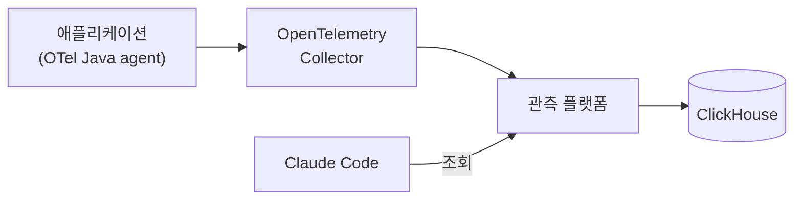
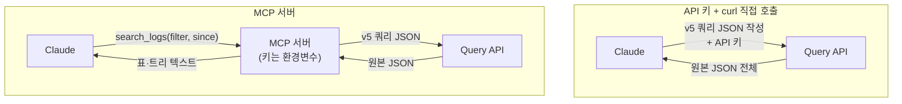

## 서론

저희 회사는 SigNoz라는 모니터링 툴을 사용하고 있습니다. 애플리케이션의 로그·트레이스·메트릭이 모두 여기에 쌓입니다. 요즘은 장애나 이상한 동작을 조사할 때 웹 화면을 직접 뒤지기보다 Claude Code에게 "이 job이 왜 실패했는지 로그에서 찾아봐"라고 맡기는 일이 많아졌습니다.

그런데 그 조회가 너무 비쌌습니다. 로그 5행을 가져왔는데 응답이 30만 자가 넘었고, 트레이스 하나를 펼치면 26만 자가 나왔습니다. 원인을 좁히기도 전에 컨텍스트가 조회 결과로 가득 찼습니다.


*그림 1. 조회 한 번의 결과가 책상을 다 덮어 버리는 상황입니다*

그래서 플랫폼이 제공하는 공식 MCP 서버를 쓰는 대신 **읽기 전용이고 응답을 작게 줄여 돌려주는 MCP 서버**를 따로 만들었습니다. 같은 로그 20행이 37,128자에서 4,848자로, 같은 트레이스가 230,032자에서 8,609자로 줄었습니다.

이 글에서는 왜 만들었는지, 무엇을 남기고 무엇을 버렸는지, 만들면서 걸린 곳은 어디였는지를 순서대로 정리했습니다. 중간에는 MCP 대신 API 키를 넘겨 에이전트가 직접 호출하게 하는 방식과 같은 질의로 실측 비교해서 각각의 장단점과 한계도 짚어 봤습니다.

## SigNoz는 어떤 도구일까

SigNoz는 관측(Observability) 플랫폼입니다. Datadog이나 New Relic처럼 로그·트레이스·메트릭을 한 화면에서 보고 알림과 대시보드를 만들 수 있는데, 오픈소스라 직접 서버에 설치해 운영할 수 있다는 점이 다릅니다. 저희도 사내 서버에 설치해서 씁니다.

OpenTelemetry를 그대로 받는다는 점이 먼저 눈에 띕니다. 애플리케이션에 OpenTelemetry 에이전트를 붙여 두면 SigNoz 전용 SDK 없이 데이터가 들어오고, 나중에 저장소를 바꾸더라도 애플리케이션 쪽 계측은 그대로 둘 수 있습니다. 저장소는 컬럼 기반 DB인 ClickHouse라서 로그와 span처럼 양이 많은 데이터를 집계하는 데 강합니다.

저희 구성에서는 애플리케이션이 내보낸 텔레메트리를 OpenTelemetry Collector가 받아 SigNoz로 보내고, SigNoz는 그것을 ClickHouse에 저장합니다.



*그림 2. 텔레메트리가 쌓이는 경로와 Claude가 조회하는 지점*

Claude가 플랫폼을 조회하는 방법은 세 가지였습니다.

| 방법 | 방식 | 필요한 것 |
| --- | --- | --- |
| Query API 직접 호출 | `POST /api/v5/query_range`를 curl로 부릅니다 | 플랫폼 API 키 |
| ClickHouse 직접 조회 | 서버에 SSH로 들어가 컨테이너 안에서 SQL을 실행합니다 | SSH 자격 |
| MCP 서버 | MCP 도구를 부르면 서버가 Query API를 대신 부릅니다 | MCP 서버 설치 + API 키 |

ClickHouse 직접 조회는 임의 SQL이 되지만 SSH 권한이 필요하고 플랫폼 내부 테이블 구조에 그대로 묶입니다. 그래서 평소에는 앞의 두 방법 중 하나를 썼습니다.

참고로 이 플랫폼은 다른 제품 팀과 같이 쓰는 공용 서버입니다. 이 점이 뒤에서 "읽기 전용"을 강하게 고집한 이유가 됩니다.

## MCP는 왜 만들게 되었을까

팀에 합류한 초반에는 SigNoz 화면이 낯설었습니다. 어떤 필드로 걸러야 하는지, 어떤 span이 어떤 코드에서 나오는지를 아직 몰랐습니다.

그래서 조사를 점점 Claude Code에게 맡기게 됐습니다. 저장소에는 아예 텔레메트리 조사 전용 서브에이전트가 있습니다. 조회는 서브에이전트가 자기 컨텍스트에서 하고 호출한 쪽에는 결론 20줄만 돌려주는 구조입니다. 이 에이전트를 만든 이유부터가 "토큰 절약"이었습니다. 조회 결과가 그만큼 크다는 걸 이미 알고 있었던 셈입니다.

그런데 조회 수단 자체에 각각 걸리는 점이 있었습니다.

- 기존 조사 스킬의 기본은 SSH로 서버에 들어가 ClickHouse를 직접 조회하는 방식이었습니다. 임의 SQL이 되지만 SSH 자격이 있는 사람만 쓸 수 있었습니다.
- Query API를 curl로 부르면 SSH는 필요 없지만 원본 JSON을 받습니다. 그대로 읽으면 컨텍스트에 다 들어옵니다.
- 그래서 공식 MCP 서버를 붙여 봤는데, 이쪽도 응답이 원본과 크게 다르지 않았습니다.

결국 어느 경로로 가든 조사를 시작하기 전에 컨텍스트가 먼저 바닥나는 상황이었습니다. 서브에이전트로 메인 대화를 지켜도 서브에이전트 자신의 컨텍스트는 조회 몇 번이면 찼습니다. 응답을 줄이는 일을 누군가는 해야 했고, 그걸 매번 모델에게 맡기지 말고 도구에 넣어 두자는 게 출발점이었습니다.

## 응답은 왜 그렇게 컸을까

처음에는 공식 `SigNoz/signoz-mcp-server`(v0.15.0)를 붙여 봤습니다. 사내 서버에 붙여 최근 1시간 데이터로 재 본 결과는 이랬습니다.

| 질의 | 공식 MCP 서버 응답 |
| --- | ---: |
| 로그 검색 5행 (stacktrace가 있는 시간대) | 301,288자 |
| 트레이스 상세 1건 (149 span) | 264,675자 |
| 트레이스 집계 top 10 | 687자 |
| 메트릭 조회 1시간 | 3,234자 |

집계와 메트릭은 가벼웠습니다. 무거운 건 로그와 트레이스처럼 행을 그대로 가져오는 조회였습니다.

원인은 공식 서버가 v5 `query_range` 응답을 거의 그대로 넘긴다는 데 있었습니다. 로그 한 행이 실제로 어떻게 생겼는지 보면 바로 이해됩니다.

```json
{
  "body": "order created orderId=1001 amount=12000 ...",
  "severity_text": "INFO",
  "scope_name": "com.example.order.OrderService",
  "trace_id": "4bf92f3577b34da6a3ce929d0e0e4736",
  "attributes_string": { "order_id": "1001", "store_id": "S-01" },
  "resources_string": {
    "container.id": "3f2a9c1e7b4d5a6f8e9d0c1b2a3f4e5d6c7b8a9f0e1d2c3b4a5f6e7d8c9b0a1f",
    "host.arch": "amd64",
    "os.description": "Linux 6.x-cloud-amd64",
    "process.command_args": "[\"/usr/bin/java\",\"-javaagent:...\",\"-jar\",\"/app/app.jar\"]",
    "process.runtime.description": "OpenJDK 64-Bit Server VM 21.x",
    "telemetry.sdk.version": "1.x.x"
    // ... 이하 생략 (실제 응답에서는 행마다 resource가 20개 안팎)
  }
}
```

*※ 실제 응답의 필드 구조만 따른 예시 데이터입니다. 서비스, 클래스, ID, 값은 모두 가상입니다.*

조사에 필요한 건 `body`, 시각, 레벨, `trace_id`, 그리고 `order_id` 같은 업무 속성 몇 개입니다. 그런데 행마다 컨테이너 ID, OS 버전, JVM 실행 인자 같은 resource가 20여 개씩 붙어 옵니다. 대부분 행마다 같은 값인데도 매번 반복됩니다. 에러 로그라면 여기에 `exception.stacktrace`가 통째로 실립니다.

트레이스는 더 심했습니다. span 하나가 48개 컬럼으로 오는데 대부분이 null이나 빈 문자열이었습니다.

도구 정의도 부담이었습니다. 공식 서버는 도구 43개를 제공하고 그 정의만 214,751자였습니다. 대시보드·알림·채널을 만들고 고치는 도구까지 들어 있어서 제가 한 번도 쓰지 않을 도구 설명이 세션마다 컨텍스트에 실렸습니다.

기능은 모자라지 않았습니다. 조사에 쓰지 않는 데이터가 컨텍스트를 차지하고 있었을 뿐입니다.

## 왜 공식 서버를 고치지 않고 새로 만들었을까

공식 서버에 응답 압축 옵션을 넣는 방법도 생각했습니다. 그러지 않은 데는 이유가 있었습니다.

- 공식 서버는 Go로 6만 4천 줄 정도 되는 프로젝트입니다. 제가 원한 건 반복해서 쓰는 조사 경로 몇 개를 작게 만드는 정도였고, 범용 클라이언트를 손볼 생각은 없었습니다.
- 기여를 하더라도 언제 머지될지 제가 정할 수 없습니다. 당장 매일 쓰는 도구라 기다릴 수 없었습니다.

그리고 공식 서버와 병행하지도 않기로 했습니다. 집계·메트릭은 공식 서버도 가볍지만 직접 구현해도 수십 줄이면 끝나는 일이라 서버 두 개를 같이 운영할 이유가 없었습니다.

목표는 한 줄로 적었습니다. **같은 질문에 원본 대비 1/5 이하 크기로 답하는 읽기 전용 MCP 서버.** 부차적인 목표는 Claude가 v5 쿼리 JSON을 매번 손으로 짜지 않게 하는 것이었습니다.

## 그런데 MCP가 꼭 필요했을까

여기서 한 번 짚고 넘어가야 할 질문이 있습니다. 공식 서버가 무거우면 MCP를 버리고 API 키를 넘겨서 Claude가 Query API를 curl로 직접 부르게 하면 되지 않을까요? 저희 저장소의 텔레메트리 조사 스킬도 원래는 SSH + ClickHouse 직조회를 기본으로 두고 Query API를 대안으로 적어 두고 있었습니다. 공식 MCP를 걷어내면 그 대안이 기본이 됩니다.

두 방식 모두 결국 같은 Query API를 같은 API 키로 부릅니다. 차이는 요청을 누가 조립하고, 응답을 누가 줄이고, 키를 누가 들고 있느냐에 있습니다.



*그림 3. 같은 API를 부르지만 요청 조립, 응답 압축, 키 보관의 위치가 다릅니다*


*그림 4. curl 방식은 키를 들고 긴 요청을 직접 쓰고 원본을 그대로 받습니다. MCP는 키를 서버 안에 두고 짧은 요청만 넣어 한 장으로 받습니다*

### API 키를 넘겨 직접 호출하는 방식

먼저 좋은 점입니다.

- 설치가 필요 없습니다. 스킬 문서에 엔드포인트와 헤더 이름만 적어 두면 누구 환경에서든 바로 동작합니다.
- 표현력에 제한이 없습니다. Query API가 받는 쿼리라면 무엇이든 보낼 수 있습니다. 도구를 미리 정의하지 않은 질문도 처리됩니다.
- 플랫폼이 업그레이드돼도 따라갈 게 없습니다. 응답 형태가 바뀌면 Claude가 바뀐 응답을 보고 알아서 읽습니다.

단점은 매번 반복되는 비용이었습니다.

- 응답을 그대로 읽으면 원본 JSON이 컨텍스트에 들어옵니다. 아래 실측에서 stacktrace가 있는 ERROR 로그는 4행이 8만 8천 자였습니다. 셸에서 파일로 받아 걸러 읽거나 `selectFields`로 줄이면 막을 수 있지만, 그 처리를 매번 모델이 짜야 합니다.
- 쿼리 JSON을 매번 새로 짭니다. v5 쿼리는 `compositeQuery` 아래 `queries` 배열, `signal`, `filter.expression`, `order`, 시각(ms) 같은 구조를 맞춰야 합니다. 틀리면 에러를 보고 다시 짜는 왕복이 생깁니다.
- 키가 대화 안으로 들어옵니다. 모델이 curl 명령을 만들려면 키 값을 알아야 합니다. 키가 명령줄, 셸 히스토리, 대화 기록에 남습니다.
- 읽기 전용은 키 권한에만 기댑니다. 모델이 원하면 같은 키로 알림 규칙을 만드는 API도 부를 수 있습니다. 막아 주는 건 키에 붙은 역할뿐입니다.
- 줄이는 방식이 매번 다릅니다. 어떤 날은 `jq`로 필드를 고르고 어떤 날은 그냥 받습니다. 같은 질문에도 결과 모양이 달라서 앞뒤 조회를 비교하기 어렵습니다.

### MCP 서버를 두는 방식

MCP 서버는 위의 반복 비용을 서버 코드 한 곳에 고정합니다.

- **출력 계약이 고정됩니다.** 로그는 항상 같은 열의 탭 구분 표로, 트레이스는 항상 span 트리로 나옵니다. 무엇을 잘랐는지도 항상 같은 표시로 남습니다.
- **상시 비용이 작습니다.** 도구 정의 8개가 3,744자입니다. 공식 서버의 57분의 1 정도입니다.
- **키가 모델에게 보이지 않습니다.** 키는 MCP 프로세스의 환경변수로만 들어가고 모델은 도구 이름과 인자만 봅니다.
- **읽기 전용이 코드 수준에서 보장됩니다.** 쓰기 도구가 아예 없어서 모델이 원해도 부를 방법이 없습니다. 키 권한과 합쳐 이중으로 막힙니다.
- **권한을 도구 단위로 줄 수 있습니다.** 서브에이전트 정의의 `tools`에 `search_logs` 같은 MCP 도구를 하나씩 적어서 그 에이전트가 무엇을 할 수 있는지 명시할 수 있습니다.

대신 치르는 비용도 있습니다.

- 설치와 등록이 필요합니다. uv를 설치하고, 저장소를 받고, `claude mcp add`로 등록하고, 세션을 새로 열어야 합니다. Claude Desktop의 Chat에서도 쓰려면 설정 파일을 하나 더 고쳐야 합니다. curl 방식에 비하면 진입 장벽이 확실히 있습니다.
- 정의한 도구 밖의 질문은 못 합니다. 8개 도구로 안 되는 질의는 결국 curl이나 ClickHouse로 내려가야 합니다.
- 플랫폼 응답 형태가 바뀌면 제가 고쳐야 합니다. curl 방식에서는 모델이 알아서 적응하던 부분이 이제는 포매터 코드의 책임입니다.
- 압축은 정보를 버립니다. stacktrace는 앞 3줄만, resource는 아예 내보내지 않습니다. 버린 쪽에 단서가 있으면 놓칠 수 있습니다.
- 결과가 크면 줄인 출력도 큽니다. 뒤의 실측에서 span 499개짜리 trace를 트리로 펼치니 2만 8천 자가 넘었습니다. 셸에서 걸러 읽은 curl 쪽보다 컨텍스트에 더 많이 들어왔습니다.
- 유지보수자가 생깁니다. 공식 서버는 플랫폼 개발사가 관리하지만 이 서버는 제가 관리합니다. 관측 저장소를 바꾸면 이 서버도 같이 다시 만들어야 합니다.

### 같은 질의로 직접 재 봤습니다

장단점을 말로만 비교하면 감에 기대게 됩니다. 그래서 두 방식에 같은 질의를 보내 크기를 쟀습니다.

조건은 이렇게 맞췄습니다.

- 2026-10-26, 사내 SigNoz, 같은 서비스와 같은 시간 창
- curl 쪽에는 MCP 서버가 내부에서 만드는 v5 요청 본문을 그대로 보냈습니다. 요청 내용은 같고 응답을 줄이느냐만 다릅니다.
- "curl + selectFields"는 모델이 신경 써서 필요한 필드만 골라 요청한 경우입니다.
- 단위는 문자 수입니다. 토큰 수는 따로 세지 않았습니다.

| 같은 질의 | curl 원본 | curl + selectFields | MCP | MCP ÷ curl 원본 |
| --- | ---: | ---: | ---: | ---: |
| 로그 20행 (24시간) | 29,171자 | 6,469자 | 2,629자 | 약 1/11 |
| ERROR 로그 4행 (stacktrace 포함, 7일) | 88,652자 | — | 3,609자 | 약 1/25 |
| 트레이스 1건 (418 span) | 121,194자 | 137,393자 | 10,291자 | 약 1/12 |
| span 이름별 집계 top 10 | 945자 | — | 509자 | 약 1/1.9 |
| 메트릭 시계열 1시간 | 1,537자 | — | 432자 | 약 1/3.6 |

*표 1. 응답 크기 비교. curl 원본은 모델이 그대로 읽게 되는 응답 본문의 길이입니다*

요청을 보내는 쪽과 상시 비용도 함께 쟀습니다.

| 항목 | API 키 + curl | MCP |
| --- | --- | --- |
| 모델이 매번 작성하는 요청 | v5 JSON 본문 346~435자 | 도구 인자 75~112자 |
| 세션마다 실리는 도구 정의 | 없음 (대신 스킬 문서에 API 사용법) | 3,744자 (도구 8개) |
| API 키가 모델 컨텍스트에 | 들어옴 (명령줄에 키 값) | 안 들어옴 (환경변수) |

*표 2. 요청 작성량과 고정 비용 비교. 도구 정의는 `tools/list` 응답의 문자 수입니다*

차이가 큰 건 행을 가져오는 조회였습니다. 로그와 트레이스는 10배 이상 줄었고, stacktrace가 낀 ERROR 로그는 25배 가까이 줄었습니다. ERROR 로그는 행마다 stacktrace가 1만 6천~2만 3천 자씩 실려 있었습니다. 반면 집계와 메트릭은 원본도 945자와 1,537자로 작아서 줄여도 체감 차이가 크지 않습니다. 이 두 가지만 쓴다면 MCP를 만들 이유가 약합니다.

신경 써서 줄인 curl도 로그에서는 MCP의 2.5배였습니다. `selectFields`로 resource를 빼도 JSON 키 이름과 따옴표, 반복되는 `timestamp`가 남습니다. 무엇보다 이렇게 줄이는 걸 모델이 매번 기억해야 합니다.

트레이스는 `selectFields`로 오히려 커졌습니다. 이 버전은 필드를 지정하지 않으면 span마다 기본 7개 필드만 돌려줍니다. 트리를 그리려면 `parent_span_id`가 필요해서 필드를 고르면 그만큼 늘어납니다. MCP에서 크기를 줄인 건 필드 선택이 아니라 표현 방식이었습니다. span마다 반복되던 `trace_id`와 긴 timestamp를 빼고 트리로 들여쓰고, 같은 이름의 반복 호출을 한 줄로 접었습니다.

참고로 오늘 잰 curl 원본(로그 20행 29,171자)과 앞에서 본 공식 MCP 측정값(37,128자)은 날짜와 데이터가 달라 서로 직접 비교할 수는 없습니다.

### 그래서 둘 중 하나를 고르지 않았습니다

| 기준 | API 키 + curl | 공식 MCP | 직접 만든 MCP |
| --- | --- | --- | --- |
| 설치 | 필요 없음 | 필요 | 필요 |
| 상시 컨텍스트 비용 | 스킬 문서 분량 | 도구 정의 214,751자 | 도구 정의 3,744자 |
| 응답 크기 | 원본 (모델이 줄이기 나름) | 원본에 가까움 | 표·트리로 압축 |
| 쿼리 작성 | 매번 모델이 v5 JSON 작성 | 도구 인자 | 도구 인자 |
| 키 노출 | 대화·명령줄에 노출 | 환경변수 | 환경변수 |
| 쓰기 가능성 | 키 권한에 의존 | 쓰기 도구 있음 | 쓰기 도구 없음 |
| 표현력 | Query API 전부 | 넓음 | 도구 8개 범위 |
| 플랫폼 버전 변화 | 모델이 적응 | 공식 팀이 대응 | 제가 대응 |

표를 놓고 보면 어느 하나가 모든 칸에서 이기지 않습니다. 그래서 순서를 정했습니다.


*그림 5. 조회 수단의 우선순위. 편한 순서가 아니라 결합도와 필요 권한이 낮은 순서입니다*

반복되는 조사는 MCP로, MCP가 없는 팀원 환경이나 도구 범위를 벗어난 질의는 curl로, 저장 계층까지 봐야 하는 마지막 상황만 ClickHouse로 내려갑니다. MCP가 없으면 Claude가 설치를 제안한 뒤 이번 조사는 curl로 계속합니다. MCP를 유일한 경로로 만들지 않은 덕분에 "도구 8개로 충분한가"라는 질문에 부담 없이 "아니어도 괜찮다"고 답할 수 있었습니다.

## 무엇을 남기고 무엇을 버렸을까

기준은 하나였습니다. **이 값이 다음 조사 단계의 필터나 조인 키로 쓰이는가.** 쓰이면 남기고 아니면 버렸습니다. 대신 무엇이든 잘랐다면 잘랐다는 사실은 반드시 남기기로 했습니다.


*그림 6. 행마다 반복되던 꼬리표를 떼고, 다음 조사에 쓸 값만 한 줄로 남깁니다*

도구는 8개입니다.

| 도구 | 하는 일 |
| --- | --- |
| `search_logs` | 로그 검색 (최신순) |
| `aggregate_traces` | span 집계 (예: 이름별 건수와 p95) |
| `get_trace` | 트레이스 하나를 span 트리로 펼치기 |
| `query_metric` | 메트릭 시계열 요약 |
| `list_metrics` | 메트릭 이름 검색 |
| `get_field_keys` | 필터에 쓸 수 있는 키 찾기 |
| `list_alerts` | 알림 규칙과 현재 상태 |
| `list_dashboards` | 대시보드 목록 |

### 로그는 표로 바꿨습니다

같은 로그가 MCP를 거치면 이렇게 나옵니다.

```
logs 20건 (order-api, 10-07 09:25~10-07 10:25) — 더 있음
ts	level	scope	trace	body	attrs
10-07 10:15:12.996	INFO	OrderService	4bf92f35…	order created orderId=1001 …	order_id=1001
trace_id 전체: 4bf92f3577b34da6a3ce929d0e0e4736, 00f067aa…
```

*※ 위 예시 데이터를 MCP 출력 형식으로 바꾼 예시입니다. 실제로는 `body`가 300자까지 나오고 속성도 더 붙는데, 여기서는 `…`로 줄였습니다.*

- 첫 줄에 건수, 서비스, 시간 범위, 그리고 limit에 걸렸는지(`— 더 있음`)를 적습니다.
- resource는 내보내지 않습니다. 서비스 이름은 첫 줄에 이미 있습니다.
- `scope`는 패키지 경로를 떼고 클래스 이름만 남깁니다.
- `body`는 300자에서 자르고 잘린 자리에 `…(+1071자)`처럼 남은 길이를 적습니다.
- 속성은 비어 있지 않은 것만 `k=v`로 적고 stacktrace는 앞 3줄만 남깁니다.

`trace_id`는 표에서는 앞 8자만 보여 주고 표 아래에 전체 값을 한 번씩 나열했습니다. 표의 폭을 줄이면서도 "이 trace 펼쳐 줘"로 바로 이어갈 수 있게 하려는 것입니다.

### 트레이스는 트리로 바꿨습니다

```
trace 4bf92f35… 10-07 149 span, 20.2ms, 서비스 order-api
09:48:10.017 POST /orders 20.2ms
  09:48:10.017 OrderController.create 0.3ms
  09:48:10.018 OrderRepository.findById 0.8ms [ERROR]
  SELECT × 12회 (위 3개 포함), 합계 24.0ms
```

*※ 출력 형식을 보여 주는 예시입니다. 서비스와 span 이름, 시각은 모두 가상입니다.*

span마다 48개 컬럼 중 `span_id`, `parent_span_id`, 이름, 서비스, 소요 시간, 상태 여섯 개만 가져와서 부모 관계로 들여쓰기했습니다.

JDBC 반복 호출처럼 같은 부모 아래 같은 이름의 span이 10개 넘게 이어지면 처음 3개만 보여 주고 나머지는 `× N회, 합계 X ms` 한 줄로 접었습니다.

### 플랫폼의 에러 메시지는 그대로 넘겼습니다

잘못된 필드 이름으로 조회하면 플랫폼은 쓸 수 있는 필드 목록을 함께 돌려줍니다.

```
field 'scope_name' not found — valid references: span_id, ...
```

*※ 메시지 형태를 보여 주는 예시이며 실제 응답을 그대로 옮긴 것은 아닙니다.*

이 메시지를 가공하지 않고 도구 에러로 그대로 넘겼습니다. Claude가 이걸 보고 필터를 고쳐서 다시 조회합니다. 줄여야 할 건 데이터였고, 에러 메시지는 손대지 않는 편이 낫다고 봤습니다.

## 만들면서 걸린 곳은 어디였을까

설계부터 README까지는 하루에 끝났습니다. 그 하루 안에도 걸린 곳이 몇 군데 있었습니다.

### 같은 텍스트가 두 번 실리고 있었습니다

MCP Python SDK(2.x)는 기본값으로 도구 반환값을 `structured_content`에도 한 번 더 싣습니다. 텍스트를 반환하는 도구라면 같은 내용이 두 벌로 나가서, 애써 줄인 응답이 다시 두 배가 됩니다.

도구를 등록할 때 `structured_output=False`를 넘겨서 해결했습니다. 응답을 줄이려고 만든 서버가 프레임워크 기본값 하나 때문에 두 배를 쓸 뻔했습니다. 그래서 이 설정은 데코레이터 한 곳에 묶어 두고 이유를 주석으로 남겼습니다.

### 예외 메시지가 가려지고 있었습니다

플랫폼 응답 형태가 예상과 달라 `KeyError`가 나면 MCP는 메시지를 가리고 일반적인 오류로만 돌려줍니다. 그러면 Claude도 저도 무엇이 틀렸는지 알 수 없습니다.

```python
def tool(fn):
    @functools.wraps(fn)
    def surfaced(*args, **kwargs):
        try:
            return fn(*args, **kwargs)
        except ToolError:
            raise
        except Exception as e:  # ToolError 가 아니면 MCP 가 메시지를 가린다
            raise ToolError(f"내부 오류 {type(e).__name__}: {e} — SigNoz 응답 형태가 바뀌었을 수 있다") from e
    return mcp.tool(structured_output=False)(surfaced)
```

예상하지 못한 예외를 `ToolError`로 바꿔 원인을 드러내도록 했습니다. 응답 형태가 바뀌는 건 이 서버의 가장 현실적인 고장이라서 그때 바로 알아볼 수 있어야 했습니다.

### 실제 데이터는 테스트 fixture보다 지저분했습니다

포매터 테스트는 실제 응답에서 잘라 만든 fixture로 돌렸습니다. 실서버에는 도구 8개를 하나씩 불러 보는 smoke 스크립트를 따로 두었습니다. 그런데 첫 버전을 올린 뒤 fixture에 없던 데이터를 만났습니다.

- 부모 관계가 고리를 이루는 트레이스가 있었습니다. 트리를 만들다 무한히 돌 수 있어서 `(부모 순환)`으로 표시하고 끊었습니다.
- 메트릭 값과 집계 셀에 null이 섞여 왔습니다. 통계를 낼 때 건너뛰도록 고쳤습니다.

둘 다 그날 바로 고치고 테스트에 케이스를 추가했습니다. fixture는 "내가 본 데이터"까지만 보증한다는 걸 다시 느꼈습니다.

## 결과는 어땠을까

같은 사내 서버에서 같은 질의로 비교했습니다.

| 같은 질의 | 공식 MCP v0.15.0 | 직접 만든 MCP | 비율 |
| --- | ---: | ---: | ---: |
| 도구 정의 (`tools/list`) | 214,751자 (43개) | 3,744자 (8개) | 약 1/57 |
| 로그 20행 | 37,128자 | 4,848자 | 약 1/7.7 |
| 트레이스 1건 (169 span) | 230,032자 | 8,609자 | 약 1/27 |

처음 목표였던 "원본 대비 1/5 이하"는 로그와 트레이스 모두 넘겼습니다. 앞의 표 1처럼 curl로 원본을 직접 받는 방식과 비교해도 행을 가져오는 조회에서는 10배 이상 차이가 났습니다.

### 실제 조사로도 재 봤습니다

응답 크기가 줄었다고 조사가 빨라졌다고 말할 수는 없습니다. 그래서 실제 조사 두 가지를 두 방식으로 각각 세 번씩 맡겨 봤습니다. 하나는 응답이 작은 조사이고, 다른 하나는 응답이 큰 조사입니다.

첫 번째 조사는 "정해진 일주일 동안의 ERROR 로그를 모두 찾아 원인별로 묶고, 가장 최근 건의 trace를 펼쳐 실제로 에러가 난 span을 짚어라"였습니다. 그 기간의 ERROR 로그는 3건이고 원인은 두 가지라, 정답을 미리 알고 채점할 수 있었습니다.

- 2026-10-28, 같은 저장소에서 매번 새 세션으로 돌렸습니다. 모델은 여섯 번 모두 Claude Opus 5.5입니다.
- MCP 조건은 MCP 도구를 먼저 쓰고, 안 되는 것만 curl로 내려가게 했습니다.
- curl 조건은 MCP 없이 API 키와 curl만 쓰게 했고, 필드를 골라 작게 받으라고 일러 뒀습니다.
- 두 조건 모두 서브에이전트에 맡기지 말고 직접 조회하게 했습니다. 서브에이전트가 조회하면 그 호출과 토큰이 기록에서 빠지기 때문입니다.

| 지표 (3회 평균, 괄호는 범위) | MCP | API 키 + curl |
| --- | ---: | ---: |
| 끝까지 걸린 시간 | 17.7초 (14.7~19.4) | 49.6초 (42.7~57.2) |
| 정답 로그를 처음 받기까지 | 5.2초 (3.7~6.4) | 21.6초 (16.1~29.6) |
| 도구 호출 | 4번 | 6.7번 (6~7) |
| 모델 API 요청 | 4번 | 7.7번 (7~8) |
| 쿼리가 틀려 에러를 받은 횟수 | 0번 | 1.3번 (1~2) |
| 입력 토큰 합계 | 32.3만 | 62.1만 (56.7만~65.1만) |
| 한 번에 실린 가장 큰 컨텍스트 | 8.4만 | 8.5만 |
| 출력 토큰 | 1,469 | 4,036 |
| 정답 (원인별 건수와 실패 span) | 3/3 | 3/3 |
| 어떤 제약조건에 걸렸는지까지 짚음 | 3/3 | 1/3 |
| MCP 조건에서 curl로 내려간 횟수 | 0/3 | — |

*표 3. 같은 조사를 두 방식으로 세 번씩 돌린 결과*

정답은 두 방식 모두 세 번 다 맞혔습니다. 차이는 거기까지 가는 길에서 났습니다.

curl 쪽은 회차마다 쿼리를 한두 번 틀렸습니다. 없는 필드를 넣어 에러를 받고, 고쳐서 다시 보내는 왕복이 생겼습니다. 앞에서 단점으로 적은 "쿼리 JSON을 매번 새로 짠다"가 그대로 나타났습니다. 그 결과 모델 API 요청이 두 배 가까이 됐고, 끝까지 걸린 시간도 세 배 가까이 길어졌습니다. MCP 쪽은 세 번 모두 도구 4번, 요청 4번으로 같은 경로를 밟았습니다.

예상과 달랐던 점도 있습니다. 한 번에 실린 가장 큰 컨텍스트는 두 방식이 거의 같았습니다(8.4만 대 8.5만). 이번 조사는 ERROR 로그가 3건뿐이라 응답 자체가 작았고, 컨텍스트 대부분은 세션 기본 설정이 차지했습니다. 그런데도 입력 토큰 합계가 두 배 난 이유는 요청 횟수입니다. 모델에 요청을 보낼 때마다 그때까지의 컨텍스트 전체가 다시 실리기 때문에, 왕복이 늘어난 만큼 합계가 불어났습니다. 이 합계의 8~9할은 캐시에서 다시 읽은 토큰이라, 그대로 비용 차이로 읽으면 안 됩니다.

정보의 깊이에서도 차이가 보였습니다. MCP는 세 번 모두 어떤 제약조건에 걸렸는지까지 짚었고, curl은 세 번 중 한 번만 짚었습니다. curl 쪽은 어떤 필드를 받을지 매번 모델이 정했고, 그 선택에 따라 이 정보가 결과에 들어오기도 하고 빠지기도 했습니다. MCP는 출력 필드가 고정돼 있어서 세 번 모두 같은 정보를 받았습니다.

두 번째 조사는 응답이 큰 경우입니다. span이 499개인 trace 하나를 정해 두고 span 수, 루트를 뺀 가장 오래 걸린 span, 가장 많이 반복된 span과 그 횟수를 물었습니다. 이 trace를 curl로 그냥 받으면 응답이 15만 자가 넘습니다. 조건은 첫 번째 조사와 같습니다.

| 지표 (3회 평균, 괄호는 범위) | MCP | API 키 + curl |
| --- | ---: | ---: |
| 끝까지 걸린 시간 | 25.0초 (19.3~28.4) | 40.6초 (25.2~50.8) |
| 정답 span을 처음 받기까지 | 11.9초 (7.1~17.3) | 27.1초 (18.6~43.9) |
| 모델 API 요청 | 3.7번 (3~4) | 5.3번 (4~7) |
| 조회 기간을 잘못 넣어 다시 조회 | 0/3 | 2/3 |
| 컨텍스트에 들어온 도구 결과 | 3.5만 자 | 2,819자 (1,684~4,708) |
| 한 번에 실린 가장 큰 컨텍스트 | 9.8만 | 8.3만 |
| 입력 토큰 합계 | 32.2만 (25.7만~35.5만) | 43.1만 (31.9만~56.7만) |
| 출력 토큰 | 1,407 | 3,610 |
| 정답 (세 문항 모두) | 3/3 | 3/3 |
| MCP 조건에서 curl로 내려간 횟수 | 0/3 | — |

*표 4. 응답이 큰 조사를 두 방식으로 세 번씩 돌린 결과*

이번에도 정답은 두 방식 모두 세 번 다 맞혔고, 시간과 왕복은 MCP 쪽이 적었습니다. 그런데 컨텍스트는 예상과 반대로 나왔습니다.

curl 쪽 에이전트는 세 번 모두 응답을 파일로 받아 Python이나 jq로 집계하고, 그 결과만 읽었습니다. 그래서 15만 자가 넘는 원본은 컨텍스트에 한 번도 들어오지 않았고, 들어온 도구 결과는 3천 자 안팎이었습니다. MCP 쪽은 499개 span을 트리로 펼친 출력 2만 8천 자를 그대로 읽어서, 한 번에 실린 컨텍스트가 오히려 1만 5천 토큰쯤 더 컸습니다.

셸을 쓸 수 있는 에이전트라면 curl로도 원본을 컨텍스트 밖에 둘 수 있었던 셈입니다. 다만 그 집계 코드를 매번 새로 짰고, 세 번 중 두 번은 조회 기간을 잘못 넣어 빈 결과를 받은 뒤 다시 조회했습니다. 그 왕복만큼 시간과 출력 토큰이 더 들었습니다. 이 조사에서 MCP가 아낀 건 컨텍스트가 아니라 조회를 짜고 고치는 과정이었습니다.

숫자 말고 달라진 점도 있습니다.

조사 에이전트도 이제 MCP를 먼저 씁니다. 제품 저장소의 텔레메트리 조사 스킬과 서브에이전트가 MCP 도구가 보이면 그것부터 쓰고, 없으면 설치를 제안한 뒤 curl로 진행하도록 바꿨습니다. 여러 번 조회해야 하는 원인 조사는 서브에이전트가 자기 컨텍스트에서 하고 결론 20줄만 돌려줍니다.

팀원도 쓸 수 있도록 README를 처음 쓰는 사람 기준의 설치 가이드로 다시 썼고, API 키는 각자 플랫폼의 Service Account에 viewer 역할로 발급받게 했습니다.

다만 이 결과에서 주장할 수 있는 범위는 정해 두었습니다. 응답 크기 비교(표 1과 이 절의 첫 표)는 문자 수로 쟀습니다. 조사 시간과 토큰은 표 3과 표 4의 조사 두 가지, 조건별 세 번씩으로만 쟀습니다. 두 조사 모두 도구 8개로 답할 수 있는 조사였고, 그 범위를 벗어나는 조사는 넣지 않았습니다. 그래서 "조사가 몇 배 빨라졌다"처럼 일반화하지 않고, 이 조사들에서는 이렇게 나왔다는 것까지만 말합니다.

## 후기

### 문제는 기능이 아니라 계약이었습니다

처음에는 "공식 MCP가 너무 무겁다"고만 생각했습니다. 만들고 나서 보니 공식 서버를 탓할 일은 아니었습니다. 공식 서버는 플랫폼으로 할 수 있는 모든 일을 할 수 있게 만든 범용 도구이고, 제가 필요했던 건 매일 같은 방식으로 반복하는 조사 몇 가지였습니다.

MCP 서버를 만들면서 실제로 한 일은 모델과 시스템 사이의 계약을 좁히는 것이었습니다. 무엇을 물을 수 있는지(도구 8개), 무엇을 돌려받는지(표와 트리), 무엇을 할 수 없는지(쓰기)를 코드로 정해 두는 일입니다. 컨텍스트를 키우면 해결되지 않느냐는 질문을 받을 수도 있는데, 컨텍스트가 커져도 쓰지 않는 데이터를 매번 읽는 비용과 그 사이에서 신호를 찾는 비용은 그대로 남습니다.

### MCP는 저장소에 묶입니다

관측 저장소는 언젠가 바뀔 수 있습니다. 다른 스택으로 옮기게 되면 이 MCP 서버도 다시 만들어야 합니다.

curl 방식이었다면 스킬 문서의 엔드포인트만 바꾸면 됐을 일입니다. 직접 만든 MCP는 응답을 줄이는 대가로 특정 저장소의 응답 형태에 묶입니다. 그래도 다시 만든다면 같은 방식으로 만들 것 같습니다. 이번에 정한 기준인 "다음 조사 단계에 쓰이는 값만 남기고, 자른 건 표시한다"는 저장소가 바뀌어도 그대로 쓸 수 있기 때문입니다.

## 마무리

정리하면 이번 작업에서 가져간 결론은 이렇습니다.

> LLM에게 관측 데이터를 보여 줄 때 중요한 건 얼마나 많이 보여 주느냐가 아니라, 다음 질문에 필요한 것만 같은 모양으로 보여 주는 것이다.

그래서 자주 하는 조사는 계약을 좁힌 MCP로 하고, 그 밖의 질문은 범용 API로 내려갈 길을 남겨 두었습니다. 지금 제 환경에서는 이 조합이 가장 덜 비싸고 덜 위험했습니다.
